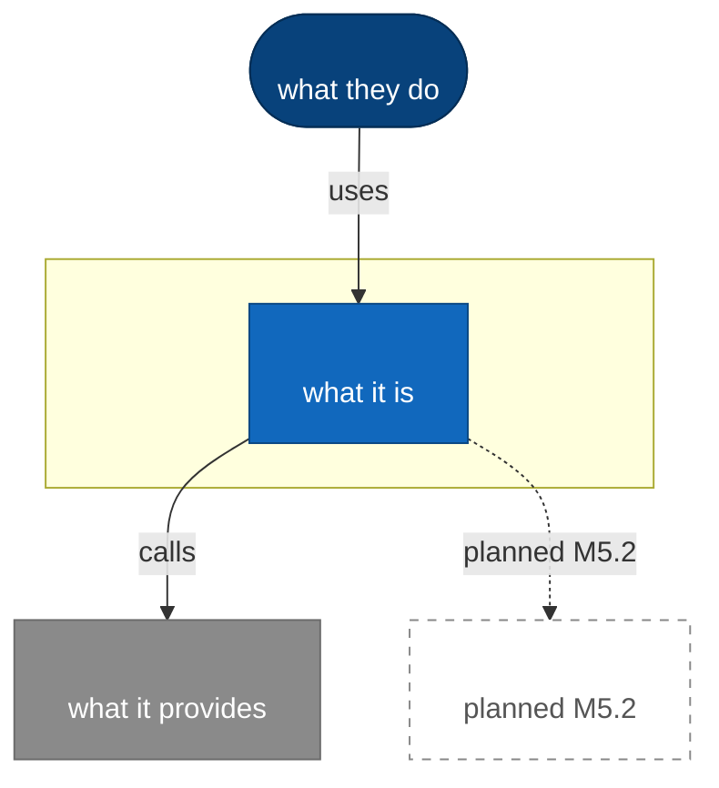

# Draw or rebuild the architecture diagrams

Requested: `$ARGUMENTS` (empty means every diagram).

This skill keeps a folder of diagrams that show how the project is built: what it is, what it
deals with, its parts and how they depend on each other, its main types, and how it behaves.
The first run creates the folder; later runs rebuild only what changed. Bold names are values
from the "Project details" of the adopted rules: **Diagrams**, **Specs**, **Decision log**,
**Task IDs**, and **Docs folder** from `roadmap-and-docs.md`, and **Git access** from
`commits.md`. The text follows `writing.md`.

The diagrams live where the **Diagrams** value says. Without that value, use `diagram/` at the
repository's root, and say so in the report.

## Conventions

These hold for every diagram, so readers learn them once:

- **Mermaid in Markdown, and nothing else.** GitHub draws Mermaid blocks, they diff as text, and
  no image goes stale beside its source. Don't commit generated images.
- **The code wins.** Draw what the code has, under its real names. When a diagram and the code
  disagree, the code is right, and the diagram changes.
- **Built is solid; planned is dashed.** A part the roadmap plans but the code lacks is drawn
  with a dashed border or a dotted arrow, and labeled with the task that builds it
  (`planned M5.2`), in the **Task IDs** format. Name a planned part as its spec in the **Specs**
  does. Without a roadmap, draw only what is built.
- **Class diagrams show only types that exist.** List planned types in prose instead.
- **Every file says what it was drawn from:** the commit, the version or roadmap task, the date,
  and the sources read. A rebuild depends on this line.
- **Every diagram can be read without seeing it.** Give each Mermaid block an `accTitle` and an
  `accDescr`, and say in the paragraph above it what the reader should notice. Never show
  meaning by color alone: planned parts are dashed and labeled as well as pale.
- **Keep each diagram readable.** Aim for 25 boxes or fewer, and split a larger view into
  several.
- **Follow `writing.md`** for every title, label, and paragraph.

## The diagram set

Draw the views that inform this project, and skip the ones that would be empty:

| File | Views | Draw it when |
| --- | --- | --- |
| `README.md` | What each file shows, how to read them, and how they are kept true | Always |
| `c4-architecture.md` | C4 views: 1. system context, 2. containers, 3. the components inside each container | Always |
| `class-diagrams.md` | UML class diagrams of the main types, by area, with an overview first | The code has types worth relating |
| `component-diagrams.md` | UML component diagrams: each part with the interfaces it provides and requires | Parts meet through interfaces |
| `sequence-diagrams.md` | UML sequence diagrams of the main flows: startup, a request, the main loop, a build | There are flows across parts |
| `data-flow-and-state.md` | Data-flow diagrams, and state diagrams of the state machines | Data moves through stages, or something has states |
| `data-model.md` | Entity-relationship diagrams of what is stored | The project keeps a database or a file format |
| `deployment.md` | Where each part runs: devices, servers, stores, and CI | Parts run in more than one place |

Choose the Mermaid diagram type for each view:

| View | Mermaid type |
| --- | --- |
| C4 views, data flow, and component diagrams | `flowchart`, in C4's colors (Mermaid's own C4 diagrams are experimental) |
| Class diagrams | `classDiagram` |
| Sequence diagrams | `sequenceDiagram` |
| State diagrams | `stateDiagram-v2` |
| Data models | `erDiagram` |
| Deployment | `flowchart`, with a subgraph for each place parts run |

## 1. Find what is being asked

1. Read the **Diagrams** folder. If it has no diagrams, this run **creates** the set; otherwise
   it **rebuilds** them.
2. If `$ARGUMENTS` names a file or a view, work on that one only.
3. Tell the user in one or two sentences whether you are creating or rebuilding, and which
   diagrams. Then make a task list whose last item is "Verify and report".

## 2. Create the set

1. **Read the project before you draw it.** Read the sources that say what the project is and
   how it fits together:
   - the architecture, the **Specs**, the **Decision log**, and the roadmap in the
     **Docs folder**;
   - the manifests that list the parts and their dependencies (`Cargo.toml`,
     `settings.gradle.kts`, `package.json`, `pubspec.yaml`, `Package.swift`, and the like);
   - the entry points, the main types and interfaces, the state types, the schemas and
     migrations, and the CI and release workflows.
2. **Propose the set.** List the files and views you would draw from "The diagram set", with one
   line each on what it would show, and ask the user to confirm before you draw.
3. **Draw each file** in the shape under "File shape", from the sources you read. Draw each edge
   from a source that states it: a dependency from a manifest or a dependency matrix, a call
   from the code, and an ownership from a field.
4. **Write the `README.md` index**, in the shape under "The index".

## 3. Rebuild the set

1. For each file, read its "Drawn from" line: the commit and the sources.
2. See what changed since then: `git diff --stat <commit>..HEAD -- <sources>`, the roadmap tasks
   ticked since, and the decision records added or superseded since.
3. For each view whose sources changed, redraw what changed, and only that:
   - parts and dependencies added or removed, from the manifests;
   - types renamed, added, or removed, and relations that changed;
   - flows and states that changed;
   - planned parts that are now built, redrawn solid, with the task label removed;
   - planned parts whose spec renamed or dropped them.
4. Update the file's "Drawn from" line and its entry in the index. Leave a file whose sources
   didn't change as it is, and say so in the report.
5. If a diagram disagrees with the code in a way the change history doesn't explain, the diagram
   was already wrong: correct it, and say so.

## File shape

Start every diagram file with its title, what it was drawn from, and its legend, then one
numbered section for each view:

````markdown
# C4 architecture diagrams

<What these views show, in one or two sentences.>

Drawn from commit `<hash>` (<version or roadmap task>, <YYYY-MM-DD>). Sources: <the files and
folders read>. What the roadmap plans is drawn dashed and names the task that builds it.

## Legend

| Style | Means |
| :- | :- |
| Dark blue, rounded | A person |
| Blue box | Part of the system |
| Gray box | Outside the system |
| White box with a dashed border | Planned: not built yet, with its task |
| Solid arrow | Uses, reads, writes, or depends on, as labeled |
| Dotted arrow | A planned use, with its task |

## 1. System context

<What the reader should notice in this view.>


````

- Use C4's colors for each level: people `#08427b`, systems `#1168bd`, containers `#438dd5`,
  components `#85bbf0` with dark text, and outside systems gray.
- Put a short description under each box's name (`<br/>`), so a reader learns what it is
  without leaving the diagram.
- Label every arrow with what it does: "reads", "calls", "depends on".
- Give a class diagram's legend its relationship notation instead: realization (`<|..`),
  ownership (`*--`), shared references (`o--`), associations (`-->`), dependencies (`..>`), and
  multiplicities.
- Mark sequence and state diagrams of planned work as planned in their titles and notes.

## The index

Write `README.md` in the **Diagrams** folder in this shape:

```markdown
# Diagrams

Pictures of how <the project> is built, drawn from the code and the docs as of commit `<hash>`
(<version or roadmap task>, <YYYY-MM-DD>). Each file is Markdown with Mermaid blocks, which
GitHub draws.

| File | Shows |
| :- | :- |
| [`c4-architecture.md`](c4-architecture.md) | <The views it holds> |

## Reading them

<The conventions every file shares: built and planned, the colors, and where the design lives.>

## Keeping them true

When the code and a diagram disagree, the code is right. A change to something a diagram draws
updates the diagram in the same change. Run `/draw-diagrams` to rebuild the diagrams whose
sources changed.
```

## 4. Verify

1. **Check every name.** Each box, type, and participant exists in the code under that name, or
   is labeled planned with a task that exists in the roadmap.
2. **Check every edge.** Each dependency matches its manifest or dependency matrix, each call
   matches the code, and no edge is missing between parts the sources connect.
3. **Check that every block draws.** Render each changed block with GitHub's preview or a Mermaid
   renderer, such as the Mermaid CLI (`mmdc`). If neither is available here, say so in the
   report.
4. **Check accessibility.** Every block has an `accTitle` and an `accDescr`, every view has a
   paragraph, and every legend explains every style used.
5. Do the checks in "Before finishing" in `writing.md`.

## 5. Commit only as the project allows

Follow the **Git access** level in `commits.md`, and leave the changes uncommitted unless the user
asked for a commit and that level allows it. Either way, end the report with a copy-ready commit
message, as `commits.md` describes.

## 6. Report

End with a summary that contains:

- **Mode:** created or rebuilt, and the folder.
- **Diagrams:** each file and view drawn or changed, with one line on what changed, and each one
  left as it was because its sources hadn't changed.
- **Drawn from:** the commit, version or task, and date the diagrams now reflect.
- **Corrections:** anything a diagram had wrong before this run.
- **Checks:** how each check went, and which you couldn't run, and why.
- **Questions:** anything the sources didn't settle, such as a part whose spec and code disagree.
- **Commit message:** in a `text` block, as `commits.md` describes, with no attribution lines.
