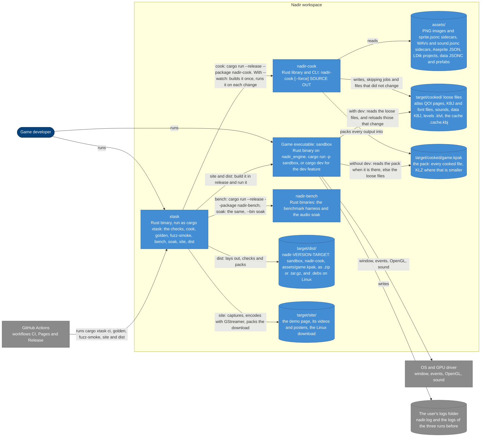
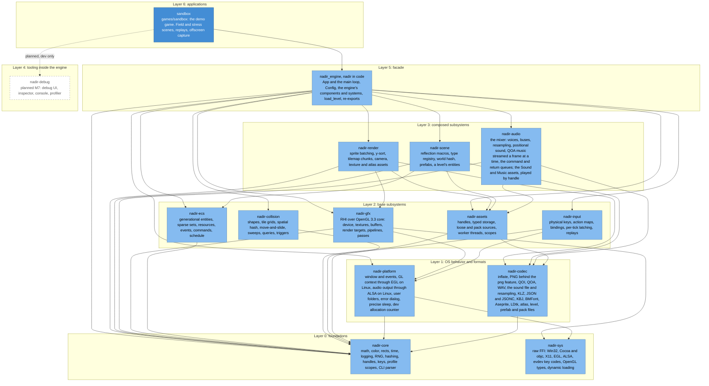
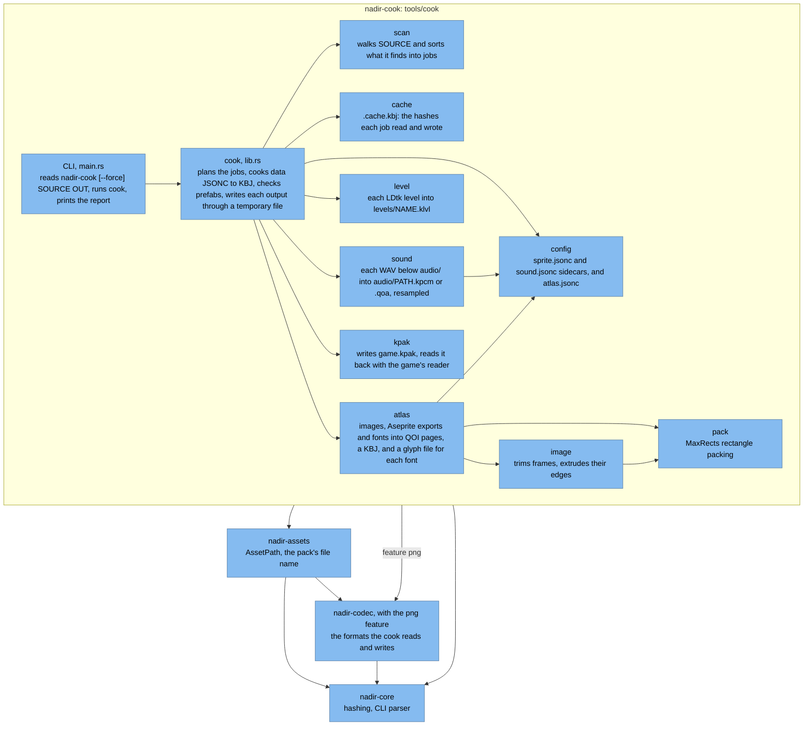
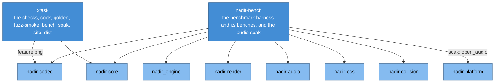

# C4 component and architecture diagrams

These diagrams show Nadir in the C4 model's views: the system and the
people and systems around it, its containers (the programs and the files
between them), and the components inside the game and the cook, which are
the workspace's crates. They reflect the code at commit 0cba65f (version
0.2). What the roadmap plans but the code does not have yet is drawn
dashed and labelled "planned".

## Legend

| Style | Means |
| :- | :- |
| Dark blue, rounded | A person |
| Blue box | Part of Nadir: a system, a container or a component |
| Grey box | A system outside Nadir |
| Cylinder | Files on disk |
| White box with a dashed border | Planned: not built yet |
| Solid arrow | Uses, reads, writes or depends on, as labelled |
| Dotted arrow | Planned: not built yet |

## 1. System context

The game built on Nadir and Nadir's own tools, with the people, editors,
OS interfaces and services they deal with. The Windows and macOS windows
are written but still wait on checks on those systems (roadmap M1.5, M1.6),
and there the game runs without drawing until their OpenGL contexts land,
and without sound until their audio output does (M6.4, M6.5).

```mermaid
flowchart TB
    developer(["Game developer<br/>writes the game, draws its sprites, lays out its levels"])
    player(["Player<br/>plays the game"])

    subgraph scope["Nadir"]
        game["Game built on Nadir<br/>the sandbox, linked with the nadir_engine facade"]
        tools["Nadir's tools<br/>nadir-cook, the asset cook, and xtask, the build automation"]
    end

    aseprite["Aseprite<br/>sprite sheets: PNG and JSON exports"]
    ldtk["LDtk<br/>level projects: .ldtk and .ldtkl files"]
    editors["Image editors and font generators<br/>PNG images, BMFont .fnt fonts"]
    fs[("Filesystem<br/>assets/ sources, target/cooked/ files and game.kpak, the game's log files")]
    os["OS window and input APIs<br/>X11 on Linux, Win32 on Windows, AppKit on macOS"]
    gpu["GPU driver<br/>OpenGL 3.3 core through EGL, on Linux"]
    gpu_planned["GPU on Windows and macOS<br/>WGL and NSOpenGL contexts, then Metal: planned"]
    audio["OS audio API<br/>ALSA, through libasound, on Linux"]
    audio_planned["Audio on Windows and macOS<br/>WASAPI and CoreAudio: planned"]
    pad_api["Gamepad APIs<br/>evdev, XInput, GameController: planned"]
    gha["GitHub Actions<br/>workflows CI, CodeQL, Pages and Release"]
    pages["GitHub Pages<br/>the demo page at jabbott.dev/Nadir"]
    channels["Release channels<br/>GitHub release and apt repository, the cook's image on ghcr.io, the crates on crates.io"]

    developer -->|"draws sprites"| aseprite
    developer -->|"lays out levels"| ldtk
    developer -->|"draws images, makes fonts"| editors
    aseprite -->|"exports into assets/"| fs
    ldtk -->|"saves projects into assets/"| fs
    editors -->|"saves into assets/"| fs
    developer -->|"writes and runs"| game
    developer -->|"runs cargo xtask"| tools
    tools -->|"reads assets/, writes target/cooked/ and game.kpak"| fs
    game -->|"reads the cooked files or game.kpak, writes nadir.log"| fs
    player -->|"plays with keyboard and mouse"| game
    game -->|"opens a window, reads its events"| os
    game -->|"draws through OpenGL 3.3 core"| gpu
    game -.->|"planned M2.6, M2.7, M10"| gpu_planned
    game -->|"plays sound through ALSA"| audio
    game -.->|"planned M6.4, M6.5"| audio_planned
    game -.->|"planned M8"| pad_api
    gha -->|"runs cargo xtask"| tools
    gha -->|"deploys the demo page"| pages
    gha -->|"publishes a tagged release"| channels
    player -->|"watches the demo, downloads the Linux build"| pages
    player -->|"downloads a release"| channels

    classDef person fill:#08427b,stroke:#052e56,color:#ffffff
    classDef system fill:#1168bd,stroke:#0b4884,color:#ffffff
    classDef external fill:#8a8a8a,stroke:#6b6b6b,color:#ffffff
    classDef planned fill:#ffffff,stroke:#888888,stroke-dasharray: 5 5,color:#555555
    class developer,player person
    class game,tools system
    class aseprite,ldtk,editors,fs,os,gpu,audio,gha,pages,channels external
    class gpu_planned,audio_planned,pad_api planned
```

## 2. Containers

The programs of the workspace and the files that pass between them. The
cook turns `assets/` into loose files and one pack, `game.kpak`; a game
built with the `dev` feature reads the loose files, and one built without
it reads the pack, or the loose files where there is no pack.

- The sandbox reads the folder `assets` beside its executable when there
  is one, as in the release files and the demo page's download, and
  `target/cooked/` otherwise.
- A pack that is there but does not open is logged, and every load then
  fails with its error: the game does not fall back to loose files that
  may not be its cook's.
- The game's asset server reads and decodes on worker threads, two fewer
  than the cores, from 1 to 4, and makes the assets on the main thread.

## 3. Components of the game executable

The crates of the game executable by layer, with an arrow for each entry
in a crate's `[dependencies]` table. The debug crate has no code and no
dependencies yet. The dotted arrow is an edge still to come: the
sandbox's to debug, behind `dev` (the matrix's row for the sandbox). The
edges the matrix allows out of debug (core, ecs, scene, render, input) are
not drawn.

- The game reaches the subsystems through the facade, which re-exports
  assets, audio, collision, ecs, input, render and scene as modules of
  `nadir`.
- `nadir_engine` uses `nadir-codec` only in its tests, as a
  dev-dependency, which the diagram leaves out; `nadir-audio`'s tests use
  `nadir-platform`'s allocation counter the same way.
- Features along these edges: the sandbox's `dev` turns on `nadir/dev`,
  which turns on `nadir-platform/dev`, the allocation counter. No
  dependency is optional.

## 4. Components of the cook tool

The `nadir-cook` package is one library, whose `cook` function does the
work, and the CLI over it. Its modules are drawn with an arrow to each
module whose items they use, and the package's three workspace
dependencies below. The error type's module, `error.rs`, which most of
them use, is left out.

## 5. The workspace's other programs

`xtask` and `nadir-bench` are not part of the game or the cook. `xtask`
links only `nadir-core` and `nadir-codec`, and runs the other packages
through cargo.

## The crates

Every workspace member, its layer, its `unsafe` policy and its direct
workspace dependencies. "deny" is the workspace's `unsafe_code = "deny"`,
which every member inherits through `[lints] workspace = true`. "allowed"
is a `#![allow(unsafe_code)]` in the crate's `src/lib.rs`; there clippy's
`undocumented_unsafe_blocks` and `multiple_unsafe_ops_per_block` and rustc's
`unsafe_op_in_unsafe_fn` still deny, and `cargo xtask unsafe-audit` checks
that no other crate allows it.

| Crate | Path | Layer | `unsafe` | Direct workspace dependencies |
| :- | :- | :- | :- | :- |
| `nadir-core` | `crates/core` | 0, foundations | deny | none |
| `nadir-sys` | `crates/sys` | 0, foundations | allowed | none |
| `nadir-platform` | `crates/platform` | 1, OS behavior and formats | allowed | core, sys |
| `nadir-codec` | `crates/codec` | 1, OS behavior and formats | deny | core |
| `nadir-gfx` | `crates/gfx` | 2, base subsystems | allowed | core, platform, sys |
| `nadir-ecs` | `crates/ecs` | 2, base subsystems | deny | core |
| `nadir-assets` | `crates/assets` | 2, base subsystems | deny | core, codec |
| `nadir-input` | `crates/input` | 2, base subsystems | deny | core, platform |
| `nadir-collision` | `crates/collision` | 2, base subsystems | deny | core |
| `nadir-render` | `crates/render` | 3, composed subsystems | deny | assets, codec, core, gfx |
| `nadir-scene` | `crates/scene` | 3, composed subsystems | deny | assets, codec, core, ecs |
| `nadir-audio` | `crates/audio` | 3, composed subsystems | deny | assets, codec, core |
| `nadir-debug` | `crates/debug` | 4, tooling inside the engine | deny | none: planned, no code yet |
| `nadir_engine` (`nadir` in code) | `crates/engine` | 5, facade | deny | assets, audio, collision, core, ecs, gfx, input, platform, render, scene |
| `nadir-cook` | `tools/cook` | 6, applications | deny | assets, codec with `png`, core |
| `xtask` | `xtask` | 6, applications | deny | codec with `png`, core |
| `sandbox` | `games/sandbox` | 6, applications | deny | `nadir_engine` |
| `nadir-bench` | `bench` | 6, applications | deny | `nadir_engine`, audio, codec, collision, core, ecs, platform, render |

## Sources

- `Cargo.toml`, `.cargo/config.toml` and each member's `Cargo.toml`
- each crate's `src/lib.rs`, `tools/cook/src/main.rs`
- `crates/engine/src/app.rs`, `crates/engine/src/pack.rs`,
  `crates/engine/src/log_file.rs`, `crates/assets/src/workers.rs`
- `games/sandbox/src/main.rs`
- `xtask/src/main.rs`, `xtask/src/watch.rs`, `xtask/src/dist.rs`,
  `xtask/src/site.rs`, `xtask/src/layers.rs`
- `.github/workflows/ci.yml`, `codeql.yml`, `pages.yml`, `release.yml`
- `docs/01-architecture.md` for the layers, and `docs/roadmap.md` for
  what is planned
