# Class diagrams: data and hierarchy structures

These diagrams show the engine's main types: what each one owns, what it
refers to, and which traits it implements. They are drawn from the code at
commit 0cba65f (version 0.2). A small overview of how the crates' types
connect comes first, then one or more diagrams per subsystem. Each class
shows only a few of its fields and methods: the ones the design rests on.

## Legend

- `A <|.. B`, a dashed line with a hollow triangle: B implements the trait A.
- `A <|-- B`, a solid line with a hollow triangle: the trait B requires the
  trait A (a supertrait).
- `A *-- B`, a filled diamond: A owns B, as a field, a `Vec`, an `Option`,
  a `Box` or an enum variant's value.
- `A o-- B`, a hollow diamond: A holds B without being its only owner, such
  as a resource in the `World`, an `Arc` or a borrow.
- `A --> B`, a solid arrow: A refers to B by a handle or an id.
- `A ..> B`, a dashed arrow: A uses B in a method, or makes or returns one.
- `+` is public. `-` is private or crate-private.
- `<<trait>>`, `<<unsafe trait>>`, `<<enumeration>>`, `<<alias>>` (a type
  alias) and `<<function>>` (a free function) mark what is not a plain
  struct.
- A name such as `ecs::World` is a type from another crate, shown for
  context. `nadir::` is the engine facade, the `nadir_engine` package.
- Generic parameters show in angle brackets. References, lifetimes and the
  error type of a `Result` are left out.

Nothing here is planned work: the diagrams show only what is built. The
Metal backend, audio's output on Windows and macOS, the debug tools,
bitmap text, gamepads, saves and pathfinding are not built yet (see
`docs/roadmap.md`), so they do not appear; audio's mixer is (M6.2), its
output on Linux (M6.3), its assets (M6.9), and the game's sound (M6.6).
The members only the `dev` feature compiles, the facade's hot reload's
(roadmap M5.8), are marked `dev`. One member that exists in the code for
planned work, `ShaderSource::msl`, carries a note.

## Overview: types across crates

The core's generational index is the identity of entities, asset handles
and GPU resources. The `App` owns the ECS `World`, and the other crates'
state lives in the `World` as resources. `Graphics` is the facade's private
pair of renderer and device, which the main loop and `Offscreen` own beside
the `App`.

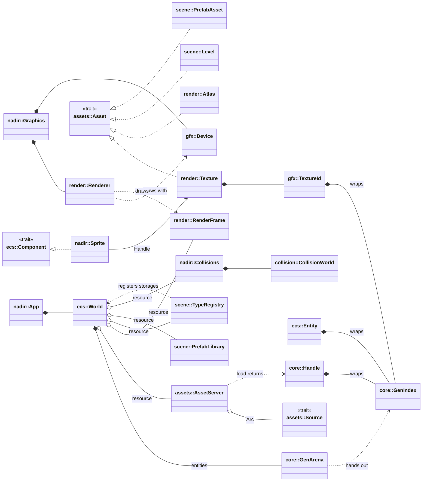

## core: generational handles

A `GenArena` stores values in reusable slots and hands out a `GenIndex` for
each. A `Handle` is a `GenIndex` tagged with the type it points at. It is
`Copy` and owns nothing.

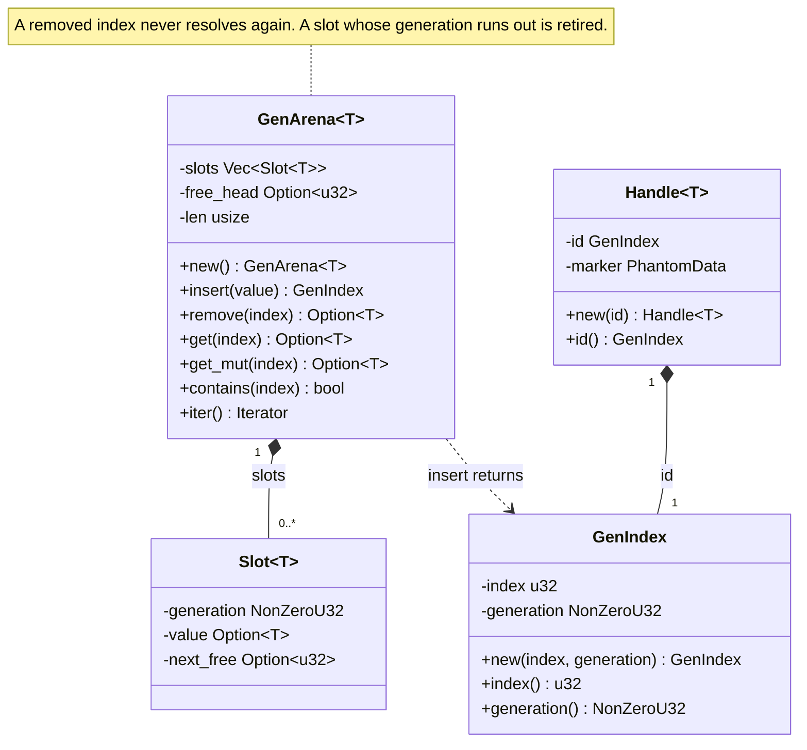

## core: math and color

The math types are plain `Copy` values. World space is +X right and +Y
down.

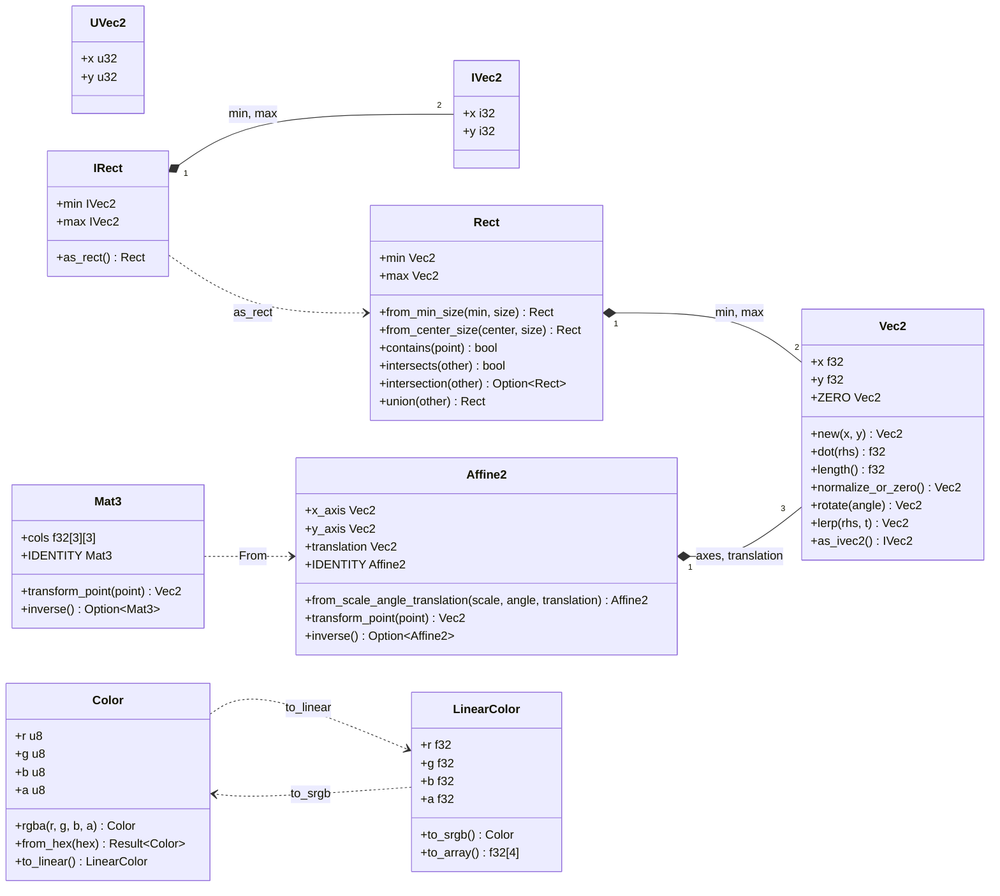

## core: time and the error enum pattern

`FixedClock` turns frame lengths into ticks of one fixed length, at the
rate it is made with: 60 Hz in the facade (`TICK_HZ`). It does not read the
time itself: the caller passes each frame's length. `CoreError` shows
the pattern every crate follows: one error enum that implements `Display`
and `std::error::Error`.

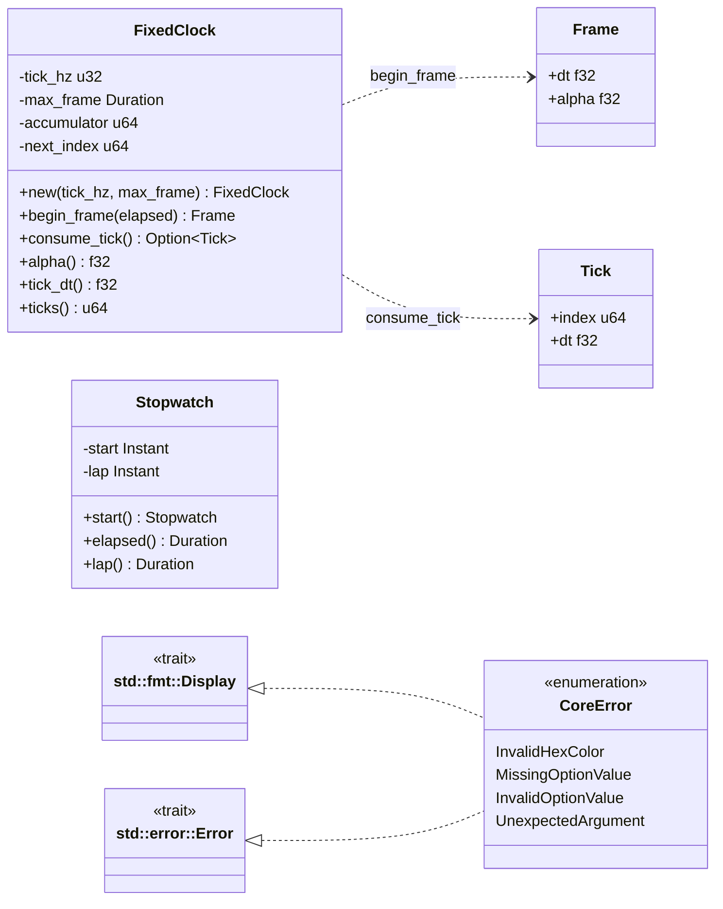

## ecs: the world and its storage

The `World` keeps the live entities in a `GenArena`, one sparse set per
registered component type, and resources by type. Each storage and resource
sits in a `RefCell`, so systems that take the `World` by shared reference
can borrow several at once. A clashing borrow panics with the system's
name. Events are resources too, which the schedule clears.

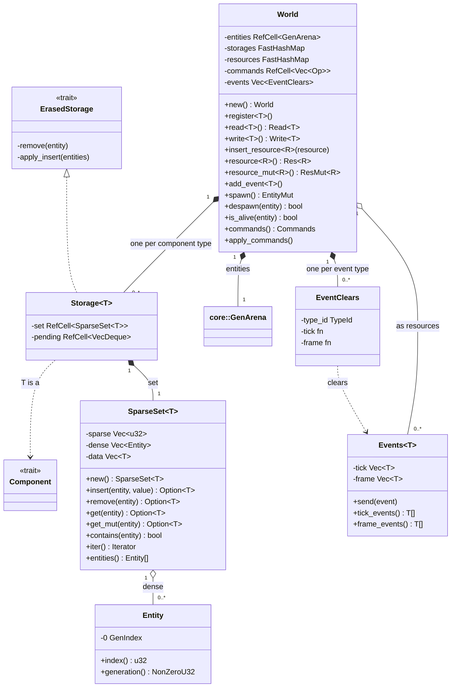

## ecs: commands, borrows and joins

Systems change the world's structure through `Commands`, which queue an
`Op` for each insert, remove and despawn; an insert's value waits in its
storage's `pending` queue. `spawn` reserves the entity at once, alive
before any command runs. `apply_commands` runs the queue at the end of
each tick and frame. `read` and `write` return borrows of a whole sparse
set. The free function `join2` makes a `Join2`, which walks the smaller of
two sets and looks each entity up in the other. `for_each_mut_with` walks a mutable
first set, whatever its size, and looks each entity up in the second.

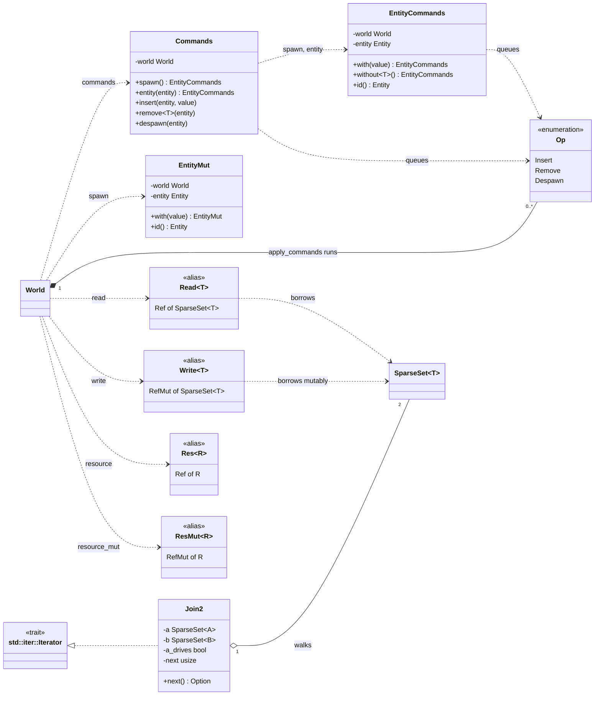

## ecs: the schedule and systems

A system is a plain function with a name. The schedule runs the fixed
stages once per tick and the frame stages once per frame, in the order of
the stage enums.

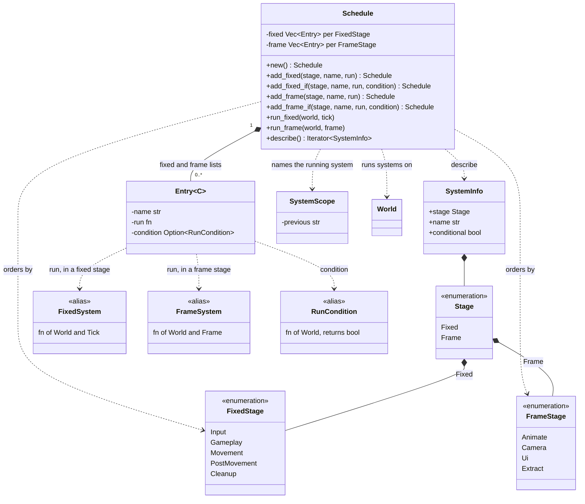

## assets: the server, its storage and its workers

The `AssetServer` keeps one typed `Assets` store per asset type behind a
private `Storage` trait. `load` hands back a handle at once, and a worker
thread reads and decodes the file. `finish_completed_loads` then finalizes
what the workers decoded. `load_now` does all of it on the caller. The pool
has from 1 to 4 threads, named `nadir-assets-N`: the number of cores minus
2.

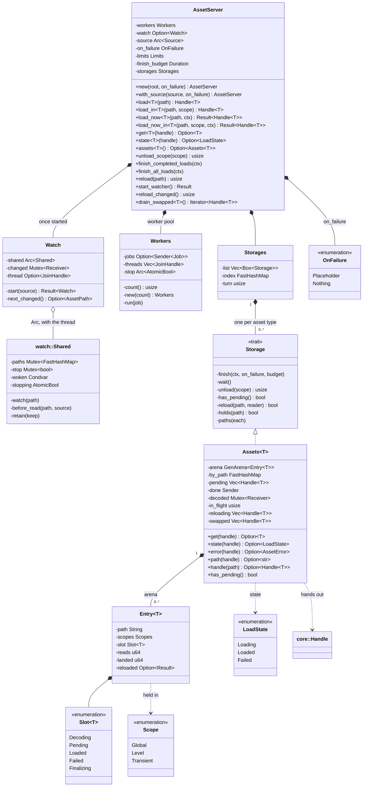

## assets: the Asset and Source traits

An asset type decodes its bytes off the main thread and finalizes the
result on it, for example by uploading a texture. A `Source` reads the
bytes: loose files, or the cook's pack `game.kpak`. In builds without the
`dev` feature, the facade reads the pack when there is one. If the pack is
there but does not open, the facade's private `Unopened` source fails every
read with the error that opening gave. `Source::modified` gives a file's
time of change to the asset server's watcher thread, `nadir-assets-watch`,
which asks it for each loaded path every 250 ms (M5.16), and which the
facade starts under `dev` (M5.8). Of these sources only `LooseSource`
overrides its default, `None`.

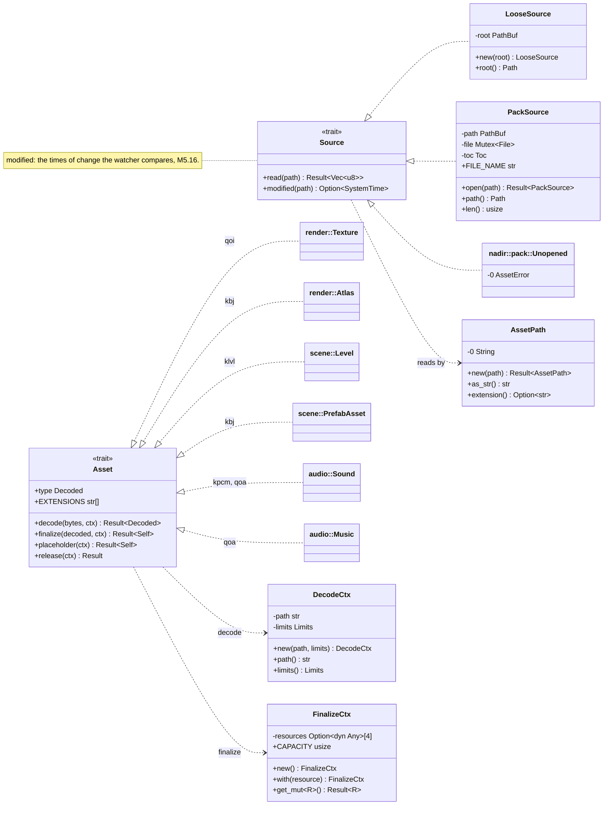

## scene: reflection

`Reflect` reads and writes a value as JSON-like `Value`s, field by field.
`FromValue` builds a new value from one. The `reflect_struct!`,
`reflect_enum!` and `reflect_newtype!` macros implement both for a type.
The scene crate implements both itself for the integers, `f32`, `f64`,
`bool`, `String`, `Vec2`, `IVec2`, `Color`, `Rect`, `Option`, `Vec` and
`Handle`.

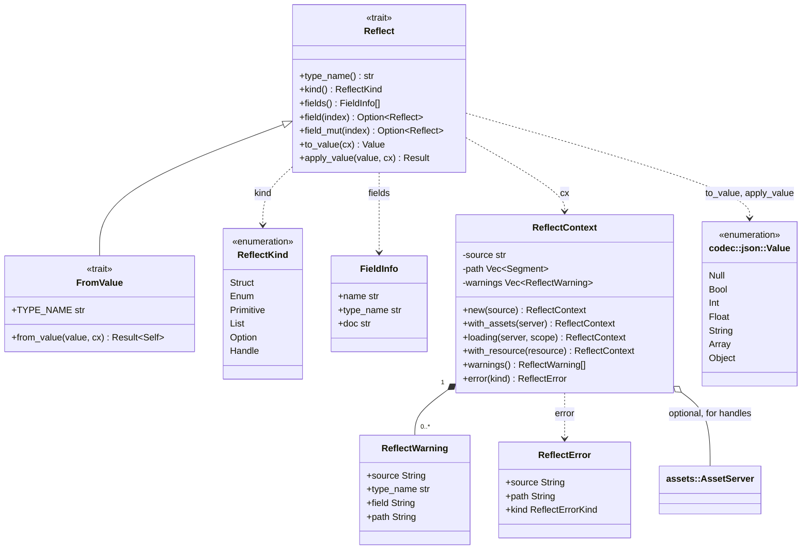

## scene: the type registry

The `TypeRegistry` keeps, for each component type, a `Registration`: the
functions that build the component from a `Value`, insert it through
`Commands`, and inspect it in a `World`.

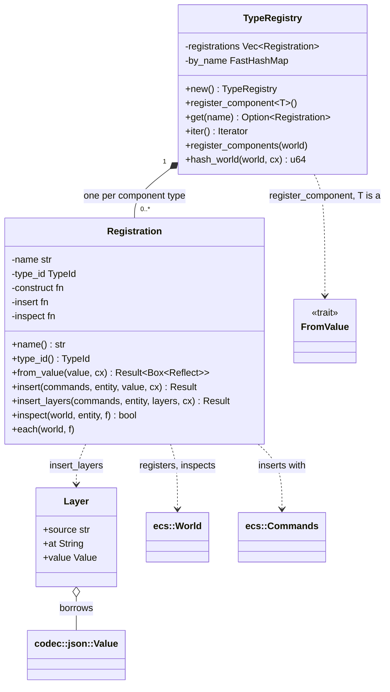

## scene: prefabs and levels

A prefab file names components and their values, and may extend another
prefab. The `PrefabLibrary` loads a prefab with its whole `extends` chain
(at most `MAX_EXTENDS`, 16) and spawns it through `Commands`. A level file,
from the cook's LDtk step, lists tilesets, tile layers, a collision grid and
entities, each an instance of a prefab.

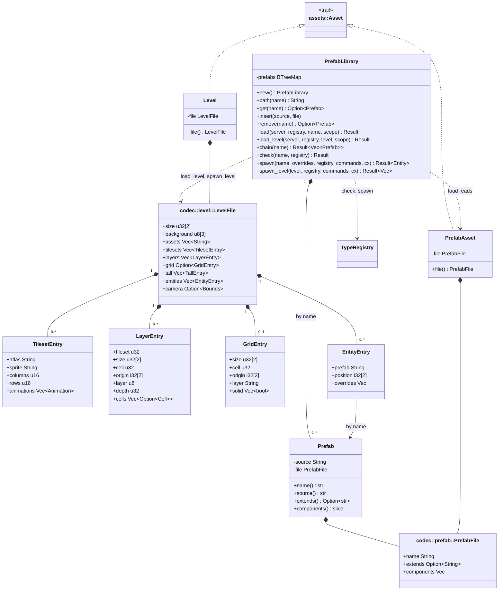

## render: the renderer

The `Renderer` draws one `RenderFrame` with the textures the asset server
holds and the tile layers in `TileLayers`. It draws the world at the
virtual resolution, then scales it up to the window by a whole number, the
`Upscale`. While the game runs, it can rebuild one of its `Program`s
from new GLSL sources, keeping the one it had when they do not build or
do not declare the program's interface.

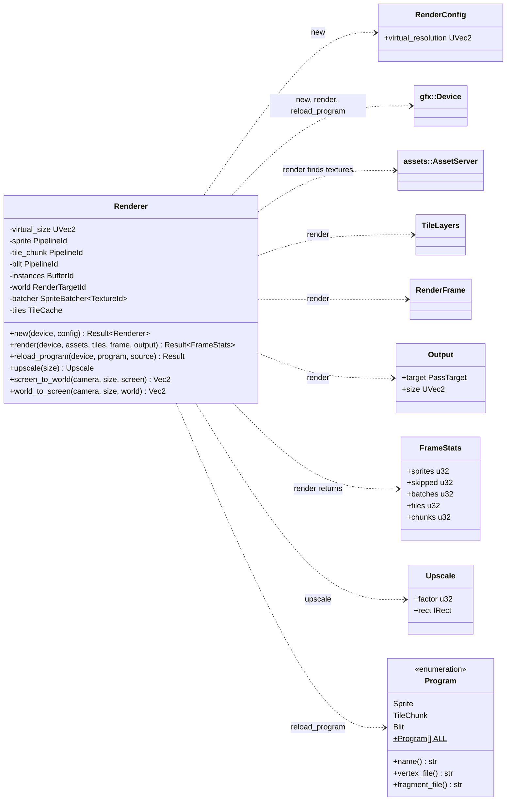

## render: batching and tile chunks

The `SpriteBatcher` sorts the frame's sprites and cuts them into batches,
each a run of sprites with one texture, drawn in one instanced draw. The
sort key is a `u64`: the layer, then the depth (the sprite's y, or a fixed
depth), then the texture, then the submission order. The `TileCache` keeps
each tile layer's chunks in GPU buffers between frames.

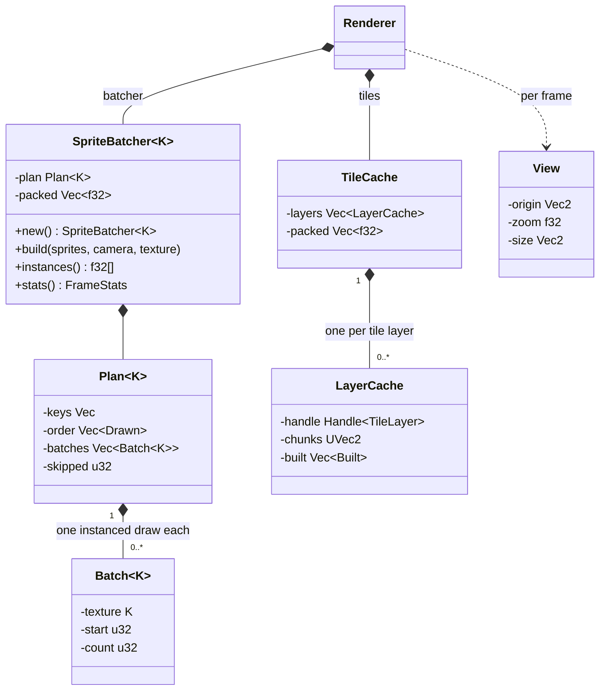

## render: a frame's contents

Each frame, the facade's extract systems fill the `RenderFrame` resource
with sprite draws and tile layer draws.

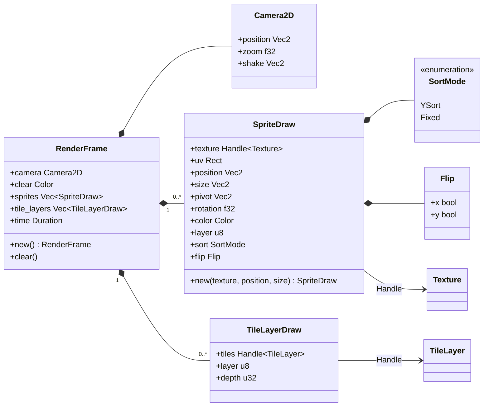

## render: textures and atlases

`Texture` and `Atlas` are assets. An atlas lists its pages, each a texture,
and its sprites with their frames and animation clips. Frames and clip
frames refer to pages and frames by index.

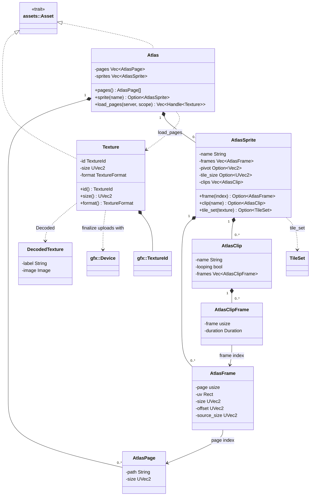

## render: tile layers

A tile layer is a grid of tiles from one tile set. The renderer draws it in
chunks of `TileLayer::CHUNK` (32) cells a side. `TileLayers` holds the
layers behind handles.

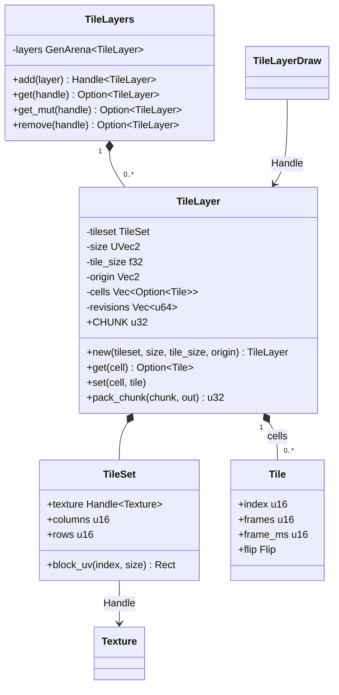

## gfx: the device and its backend

`Device` is the render hardware interface. It is one concrete type, not a
trait: today it wraps the OpenGL 3.3 core backend, `GlDevice`, and
`BackendKind` has only `OpenGl`. A device draws to a platform `GpuSurface`,
or to its own headless context. The Linux window's EGL context also
implements `GlContext`. On Windows and macOS a stand-in with no functions
does, until their GL contexts land.

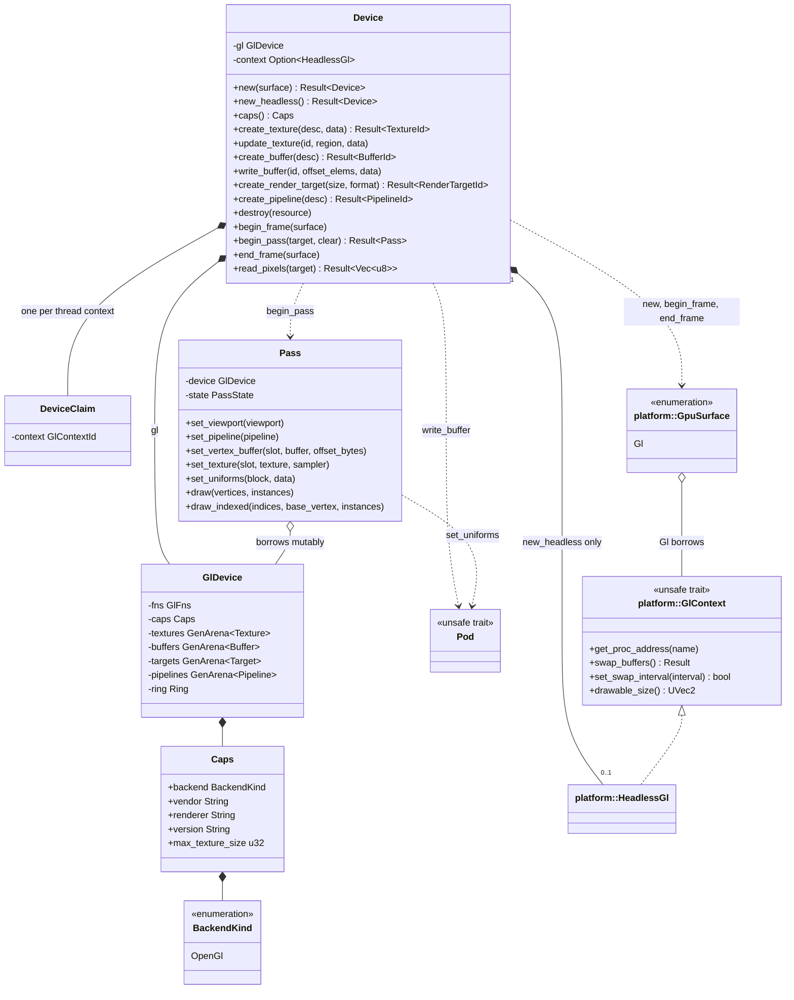

## gfx: resource ids and descriptors

The game's code sees only ids. Each is a generational index into one of the
backend's arenas, so an id of a destroyed resource stops resolving. The
descriptors say what to create.

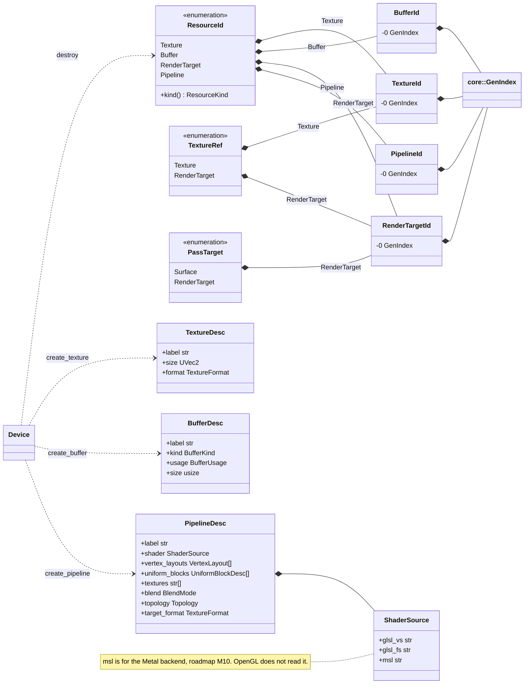

## collision: the world and its shapes

`CollisionWorld` keeps colliders by index in flat lists, a uniform spatial
hash over them, and a tile grid. Its queries write collider indices into a
list the caller passes in, so the caller can reuse it.

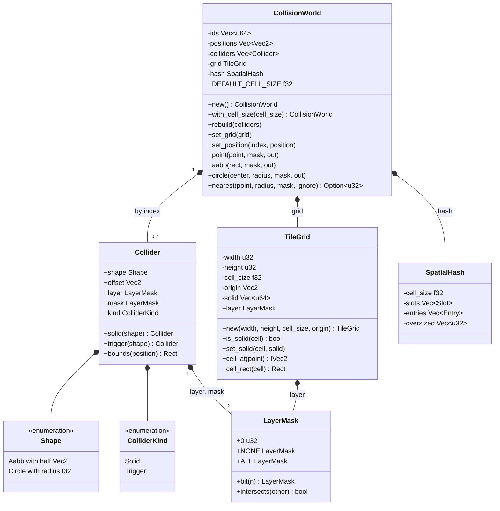

## collision: movement, sweeps and triggers

`move_and_slide` moves one collider against the others and the grid, and
reports what stopped it. The sweeps return the first hit along a path.
`Triggers` turns overlaps into entered and exited pairs. A pair's ids are
the `u64`s given to `rebuild`: the facade packs an `Entity` into each.
Pathfinding (roadmap M9.5) is not built.

```mermaid
classDiagram
    direction TB
    class CollisionWorld {
        +segment(start, end, mask, ignore) Option~SweepHit~
        +sweep_aabb(center, half, delta, mask, ignore) Option~SweepHit~
        +sweep_circle(center, radius, delta, mask, ignore) Option~SweepHit~
    }
    class Triggers {
        -current Vec~TriggerPair~
        -previous Vec~TriggerPair~
        -entered Vec~TriggerPair~
        -exited Vec~TriggerPair~
        +new() Triggers
        +update(world)
        +entered() TriggerPair[]
        +exited() TriggerPair[]
        +overlapping() TriggerPair[]
    }
    class TriggerPair {
        +trigger u64
        +other u64
    }
    class move_and_slide {
        <<function>>
        +move_and_slide(world, self_index, start, delta, out_contacts) Vec2
    }
    class Contact {
        +obstacle Obstacle
        +normal Vec2
    }
    class SweepHit {
        +obstacle Obstacle
        +t f32
        +position Vec2
        +normal Vec2
    }
    class Obstacle {
        <<enumeration>>
        Tile
        Collider
    }
    Triggers "1" *-- "0..*" TriggerPair
    Triggers ..> CollisionWorld : update reads
    move_and_slide ..> CollisionWorld : reads
    move_and_slide ..> Contact : pushes
    CollisionWorld ..> SweepHit : segment, sweeps
    Contact *-- Obstacle
    SweepHit *-- Obstacle
```

## audio: the mixer and its two sides

`nadir_audio::new` makes the two sides, which share the queues through an
`Arc`. `Audio`, on the main thread, queues a command for each call;
`Mixer`, on the audio thread, carries the commands out at the start of
each `render`, then mixes its voices and music into the buses and the
master. The sounds it is done with go back through the return queue,
and `Audio::update` drops them. `Sound` and `Music`, nadir-assets
assets, hold `SoundData` and `MusicData` in `Arc`s: `play`, `play_at` and
`play_music` look a handle up in the `AssetServer` and play what is under
it (M6.9, ADR-0050). The facade's `nadir::sound` drives `Audio` from its
components (M6.6, "engine: sound" below).

```mermaid
classDiagram
    direction TB
    class Audio {
        -shared Arc~Shared~
        -spare Mutex~Vec~Retired~~
        +play(assets, sound, params) VoiceId
        +play_at(assets, sound, position, params) VoiceId
        +play_sound(sound, params) VoiceId
        +play_sound_at(sound, position, params) VoiceId
        +stop(voice, fade_ms)
        +set_voice(voice, change)
        +set_bus_volume(bus, volume, fade_ms)
        +set_listener(position)
        +play_music(assets, track, crossfade_ms)
        +play_track(track, crossfade_ms)
        +stop_music(fade_ms)
        +update()
        +stats() AudioStats
    }
    class Mixer {
        -slots Box~Slot[]~
        -music MusicSlot[2]
        -buses Ramp[4]
        -retired Vec~Retired~
        +render(out, channels, rate)
        +count_underrun()
    }
    class Shared {
        -commands Mutex~VecDeque~Command~~
        -returns Mutex~Vec~Retired~~
        -counters atomics
    }
    class Slot {
        <<enumeration>>
        Free
        Live(Voice)
        Handoff(old, new)
    }
    class Voice {
        -id VoiceId
        -sound Arc~SoundData~
        -cursor u64
        -gains Ramp[2]
        -fade Ramp
    }
    class MusicSlot {
        -state MusicState
        -buffer Box~i16[]~
    }
    class Track {
        -music Arc~MusicData~
        -cursor u64
        -fade Ramp
    }
    class Sound {
        <<Asset>>
        -data Arc~SoundData~
        +new(data) Sound
        +data() Arc~SoundData~
    }
    class Music {
        <<Asset>>
        -data Arc~MusicData~
        +new(data) Music
        +data() Arc~MusicData~
    }
    class SoundData {
        +new(channels, sample_rate, samples) Result
    }
    class MusicData {
        -key u64
        +new(bytes) Result
    }
    class PlayParams {
        +bus Bus
        +volume f32
        +pitch f32
        +pan f32
        +looped bool
        +priority u8
        +max_instances u8
    }
    class Bus {
        <<enumeration>>
        Music
        Sfx
        Ui
        Ambience
    }
    Audio o-- Shared
    Mixer o-- Shared
    Mixer "1" *-- "voices" Slot
    Slot *-- Voice
    Mixer "1" *-- "2" MusicSlot
    MusicSlot *-- Track
    Voice o-- SoundData
    Track o-- MusicData
    Sound o-- SoundData
    Music o-- MusicData
    Audio ..> Sound : play_sound
    Audio ..> Music : play_track
    Audio ..> PlayParams : play
    PlayParams *-- Bus
```

## platform: audio output

`open_audio` starts the audio thread, which opens the device (ALSA's, on
Linux) and calls the `AudioRender` for each period, until the
`AudioStream` is dropped. The facade's private `MixerOutput` wraps the
`Mixer` in an `AudioRender`, whose `underrun` calls
`Mixer::count_underrun`, and `App::run` opens the output with it (M6.6).

```mermaid
classDiagram
    direction TB
    class open_audio["platform::open_audio"] {
        <<function>>
        +open_audio(config, render) Result~AudioStream~
    }
    class AudioOutputConfig {
        +sample_rate u32
        +channels u16
        +latency_ms u32
    }
    class AudioRender {
        <<trait>>
        +render(out, channels, sample_rate)
        +underrun()
    }
    class AudioStream {
        +latency() Option~Duration~
    }
    class Stream["linux::alsa::Stream"] {
        -stop Arc~AtomicBool~
        -thread JoinHandle
        -buffer_frames Arc~AtomicUsize~
    }
    class Pcm["linux::alsa::Pcm"] {
        -pcm NonNull~snd_pcm_t~
    }
    class MixerOutput["nadir::MixerOutput"] {
        -0 Mixer
    }
    class Mixer["audio::Mixer"]
    open_audio ..> AudioOutputConfig : takes
    open_audio ..> AudioRender : moves to the thread
    open_audio ..> AudioStream : returns
    AudioStream *-- Stream
    Stream ..> Pcm : its thread opens, writes and closes
    Stream ..> AudioRender : its thread calls
    AudioRender <|.. MixerOutput
    MixerOutput *-- Mixer
```

## engine: the App and what owns it

`App` owns the configuration, the ECS world, the schedule, the input action
set and the fixed clock. It does not own the GPU: the main loop's private
`EngineCore` owns a `Graphics` beside it, or none when there is no GPU
device. `Offscreen` does the same for headless rendering. Under `dev`,
`EngineCore` also owns the `HotReload`, where there is a `Graphics`, which
reloads what changed after each drawn frame, and its `ShaderWatch`. The
`App` holds the mixer from `App::new` until `App::run` hands it to the
audio output, `App::take_mixer` takes it, or the first `App::update`
drops it.

```mermaid
classDiagram
    direction LR
    class App {
        -config Config
        -world World
        -schedule Schedule
        -actions Actions
        -clock FixedClock
        -profile Vec~ScopeRecord~
        -shader_dir PathBuf, dev
        -mixer Option~Mixer~
        +new(config) App
        +insert_resource(resource) App
        +add_event~T~() App
        +register_component~T~() App
        +collision_layers(names) App
        +add_actions(map) App
        +play_replay(replay) App
        +add_fixed_system(stage, name, system) App
        +add_frame_system(stage, name, system) App
        +load_level(name) Result
        +world() World
        +world_mut() World
        +take_mixer() Option~Mixer~
        +update(elapsed, events)
        +world_hash() u64
        +run() Result
        +offscreen(size) Result~Offscreen~
    }
    class Config {
        +title String
        +studio String
        +game String
        +window_size UVec2
        +resizable bool
        +fullscreen bool
        +frame_rate_limit Option~u32~
        +vsync bool
        +virtual_resolution UVec2
        +assets PathBuf
        +volumes Volumes
    }
    class Volumes {
        +music u8
        +sfx u8
        +ui u8
        +ambience u8
        +get(bus) u8
        +set(bus, percent)
        +gain(bus) f32
    }
    class Actions {
        -set Option~str~
        -latch LatchFn
        -replay Option~Box~PlayReplay~~
    }
    class EngineCore {
        -app App
        -stopwatch Stopwatch
        -graphics Option~Graphics~
        -error Option~Error~
        -reload Option~HotReload~, dev
    }
    class HotReload {
        <<dev>>
        -shaders Option~ShaderWatch~
        -since Option
        -level_due bool
        -start(world, shaders) HotReload
        -frame(world, renderer, device)
    }
    class ShaderWatch {
        <<dev>>
        -dir PathBuf
        -shared Arc~Shared~
        -thread Option~JoinHandle~
        -take_changed() u64
    }
    class Graphics {
        -renderer Renderer
        -device Device
    }
    class Offscreen {
        -app App
        -graphics Graphics
        -target RenderTargetId
        -size UVec2
        +frame(elapsed, events) Result~Vec~u8~~
        +app() App
        +size() UVec2
        +renderer() str
    }
    class World["ecs::World"]
    class Schedule["ecs::Schedule"]
    class FixedClock["core::FixedClock"]
    class Renderer["render::Renderer"]
    class Device["gfx::Device"]
    class Mixer["audio::Mixer"]
    App *-- Config
    Config *-- Volumes
    App "1" *-- "0..1" Mixer : until run, take_mixer or update
    App *-- World
    App *-- Schedule
    App *-- Actions
    App *-- FixedClock
    EngineCore *-- App
    EngineCore "1" *-- "0..1" Graphics : none without a GPU
    EngineCore "1" *-- "0..1" HotReload : dev, with a GPU
    HotReload "1" *-- "0..1" ShaderWatch : if render's shaders/ is there
    HotReload ..> Renderer : reload_program
    Offscreen *-- App
    Offscreen *-- Graphics
    Graphics *-- Renderer
    Graphics *-- Device
```

`App::new` adds the engine's own systems to the schedule:
`nadir::snapshot`, `nadir::movement`, `nadir::parent_offsets` and
`nadir::triggers` in fixed stages, and `nadir::animate`, `nadir::sound`,
`nadir::extract_sprites` and `nadir::extract_level` in frame stages.

## engine: the resources App::new inserts

Every hollow diamond here is a resource in the `World`. The game reaches
them with `world.resource` and `world.resource_mut`. Three event types are
added as `Events` resources.

```mermaid
classDiagram
    direction LR
    class World["ecs::World"]
    class Input["input::Input"]
    class AssetServer["assets::AssetServer"]
    class RenderFrame["render::RenderFrame"]
    class TileLayers["render::TileLayers"]
    class FrameStats["render::FrameStats"]
    class TypeRegistry["scene::TypeRegistry"]
    class PrefabLibrary["scene::PrefabLibrary"]
    class Events["ecs::Events"]
    class Audio["audio::Audio"]
    class AudioState {
        +music_area() Option~Entity~
    }
    class TickStats {
        +ticks u32
        +time Duration
        +longest Duration
    }
    class Collisions
    class Clips
    class CollisionLayers {
        -names Vec~String~
        +new(names) CollisionLayers
        +names() String[]
    }
    class CurrentLevel
    class AnimationClock {
        -0 Duration
    }
    class FrameAllocs {
        +0 AllocCounts
    }
    class TriggerEnter {
        +trigger Entity
        +other Entity
    }
    class TriggerExit {
        +trigger Entity
        +other Entity
    }
    class AnimationFinished {
        +entity Entity
        +clip Handle~Clip~
    }
    World o-- Input
    World o-- AssetServer
    World o-- RenderFrame
    World o-- TileLayers
    World o-- FrameStats
    World o-- TickStats
    World o-- Collisions
    World o-- Clips
    World o-- CollisionLayers
    World o-- PrefabLibrary
    World o-- CurrentLevel
    World o-- AnimationClock
    World o-- FrameAllocs
    World o-- TypeRegistry
    World o-- Audio
    World o-- AudioState
    World "1" o-- "3" Events : one per event type
    Events ..> TriggerEnter
    Events ..> TriggerExit
    Events ..> AnimationFinished
    note for FrameAllocs "Only with the dev feature."
```

## engine: collision and level resources

`Collisions` wraps the collision crate's world for the ECS. It maps each
collider's index back to its `Entity` and sends `TriggerEnter` and
`TriggerExit` events. `CurrentLevel` remembers what `load_level` spawned and
loaded, so that `unload_level` can remove it.

```mermaid
classDiagram
    direction LR
    class Collisions {
        -world CollisionWorld
        -entities Vec~Entity~[2]
        -triggers Triggers
        -contacts Vec~Contact~
        +new() Collisions
        +with_cell_size(cell_size) Collisions
        +world() CollisionWorld
        +grid() TileGrid
        +set_grid(grid)
        +entity(index) Entity
        +index(entity) Option~u32~
    }
    class CurrentLevel {
        -level Option~Loaded~
        +name() Option~str~
        +background() Option~Color~
        +entities() Entity[]
        +tile_layers() TileLayerDraw[]
    }
    class Loaded {
        -name String
        -background Color
        -entities Vec~Entity~
        -layers Vec~TileLayerDraw~
        -atlases Vec~Vec~Handle~Texture~~~
        -grid bool
        -clear Color
    }
    class CollisionWorld["collision::CollisionWorld"]
    class Triggers["collision::Triggers"]
    class TileGrid["collision::TileGrid"]
    class TileLayerDraw["render::TileLayerDraw"]
    class Entity["ecs::Entity"]
    class TriggerEnter
    class TriggerExit
    Collisions *-- CollisionWorld
    Collisions *-- Triggers
    CollisionWorld *-- TileGrid
    Collisions ..> TriggerEnter : sends
    Collisions ..> TriggerExit : sends
    Collisions o-- Entity : by collider index
    CurrentLevel "1" *-- "0..1" Loaded
    Loaded o-- Entity : spawned
    Loaded "1" *-- "0..*" TileLayerDraw : layers
```

## engine: built-in components and the traits they implement

The facade defines thirteen components. All implement `Component`. Eight
also implement `FromValue`, and so `Reflect`: `App::new` registers those in
the `TypeRegistry`, so prefabs and levels can name them. `PrevTransform`,
`Parent`, `AudioListener`, `AudioEmitter` and `MusicArea` are not
reflected.

```mermaid
classDiagram
    direction LR
    class Component["ecs::Component"] {
        <<trait>>
    }
    class FromValue["scene::FromValue"] {
        <<trait>>
    }
    class Transform
    class PrevTransform
    class Velocity
    class Sprite
    class Collider
    class Player
    class Facing
    class Parent
    class SaveId
    class Animator
    class AudioListener
    class AudioEmitter
    class MusicArea
    Component <|.. Transform
    Component <|.. PrevTransform
    Component <|.. Velocity
    Component <|.. Sprite
    Component <|.. Collider
    Component <|.. Player
    Component <|.. Facing
    Component <|.. Parent
    Component <|.. SaveId
    Component <|.. Animator
    Component <|.. AudioListener
    Component <|.. AudioEmitter
    Component <|.. MusicArea
    FromValue <|.. Transform
    FromValue <|.. Velocity
    FromValue <|.. Player
    FromValue <|.. Facing
    FromValue <|.. SaveId
    FromValue <|.. Sprite
    FromValue <|.. Collider
    FromValue <|.. Animator
```

## engine: the components' data and animation

Components hold plain values, handles and entities. Each frame, `Sprite`
turns into a render crate `SpriteDraw` at the entity's position, blended
between `PrevTransform` and `Transform`. `Collider`
wraps the collision crate's collider. `Animator` plays a `Clip` from the
`Clips` resource.

```mermaid
classDiagram
    direction LR
    class Transform {
        +position Vec2
        +at(position) Transform
    }
    class PrevTransform {
        +0 Transform
    }
    class Velocity {
        +0 Vec2
    }
    class Sprite {
        +texture Handle~Texture~
        +uv Rect
        +size Vec2
        +pivot Vec2
        +rotation f32
        +color Color
        +layer u8
        +sort SortMode
        +flip Flip
        +new(texture, size) Sprite
        +from_atlas(texture, sprite, frame) Option~Sprite~
        +draw(position) SpriteDraw
    }
    class Collider {
        +0 CollisionCollider
        +solid(shape) Collider
        +trigger(shape) Collider
    }
    class Player
    class Facing {
        <<enumeration>>
        Down
        Up
        Left
        Right
    }
    class Parent {
        +entity Entity
        +offset Vec2
    }
    class SaveId {
        +0 u64
    }
    class Animator {
        -clip Handle~Clip~
        -elapsed Duration
        -finished bool
        +new(clip) Animator
        +play(clip)
        +restart()
        +is_finished() bool
    }
    class Clips {
        -clips GenArena
        -names BTreeMap
        +add(clip) Handle~Clip~
        +add_atlas(atlas, pages) Result~Vec~
        +release_atlas(pages) bool
        -reload_atlas(atlas, pages) Option~AtlasReload~, dev
        +get(handle) Option~Clip~
        +find(name) Option~Handle~Clip~~
    }
    class Clip {
        -frames Vec~ClipFrame~
        -ends Vec~Duration~
        -playback Playback
        +new(frames, playback) Clip
        +try_new(frames, playback) Result~Clip~
        +duration() Duration
        +frame_at(elapsed) usize
    }
    class ClipFrame {
        +texture Handle~Texture~
        +uv Rect
        +duration Duration
        +placement Option~Placement~
    }
    class Playback {
        <<enumeration>>
        Loop
        Once
    }
    class CollisionCollider["collision::Collider"]
    class SpriteDraw["render::SpriteDraw"]
    class Texture["render::Texture"]
    class Entity["ecs::Entity"]
    PrevTransform *-- Transform
    Sprite --> Texture : Handle
    Sprite ..> SpriteDraw : draw
    Collider *-- CollisionCollider : wraps
    Parent --> Entity
    Animator --> Clip : Handle
    Clips "1" *-- "0..*" Clip
    Clip "1" *-- "1..*" ClipFrame
    Clip *-- Playback
    ClipFrame --> Texture : Handle
```

## engine: sound

Each frame, `nadir::sound` reads the three sound components and sends the
mixer, through `Audio`, where the listener is, what each emitter plays and
where, and the track of the area the listener is in. `AudioState` keeps
what it sent: an entry for each emitter it started, or warned of, which a
private marker on the entity, `Tracked`, finds in one lookup, and the area
whose track it sent last. None of the three is reflected.

```mermaid
classDiagram
    direction LR
    class AudioListener
    class AudioEmitter {
        +sound Handle~Sound~
        +params PlayParams
        +new(sound, params) AudioEmitter
        +looped(sound) AudioEmitter
    }
    class MusicArea {
        +music Handle~Music~
        +half Vec2
        +crossfade_ms u32
        +new(music, half) MusicArea
    }
    class AudioState {
        -emitters Vec~Entry~
        -area Option
        -failed Vec
        -placed Option~Vec2~
        -listener Vec2
        -range f32
        +music_area() Option~Entity~
    }
    class Entry {
        -entity Entity
        -emitter AudioEmitter
        -voice Option~VoiceId~
        -position Vec2
    }
    class Tracked
    class Audio["audio::Audio"]
    class Sound["audio::Sound"]
    class Music["audio::Music"]
    class PlayParams["audio::PlayParams"]
    class VoiceId["audio::VoiceId"]
    class Entity["ecs::Entity"]
    AudioEmitter --> Sound : Handle
    AudioEmitter *-- PlayParams
    MusicArea --> Music : Handle
    AudioState "1" *-- "0..*" Entry
    Entry --> Entity
    Entry *-- AudioEmitter : as it was sent
    Entry "1" *-- "0..1" VoiceId : none if it did not load
    Tracked ..> Entry : marks the entity of each
    AudioState --> MusicArea : by its entity, the one sent last
    AudioState ..> Audio : the frame system sends through
```

## Error enums across crates

An error enum wraps the error that caused it, from a crate below or from
its own crate (`ClipError` in the facade, `ReflectError` in the scene
crate), so a failure keeps its cause. `ReflectError` is a struct, not an
enum. The boxes list only some variants.

```mermaid
classDiagram
    direction TB
    class EngineError["nadir::Error"] {
        <<enumeration>>
        Platform
        Render
    }
    class LevelError["nadir::LevelError"] {
        <<enumeration>>
        BadName
        Load
        Tileset
        Clips
        UnknownLayer
        Prefab
    }
    class ClipError["nadir::ClipError"] {
        <<enumeration>>
        NoFrames
        TooLong
        NameTaken
    }
    class RenderError {
        <<enumeration>>
        Gfx
        BadConfig
    }
    class GfxError {
        <<enumeration>>
        UnsupportedSurface
        StaleHandle
        Shader
        Present
        OffscreenContext
    }
    class PlatformError {
        <<enumeration>>
        Unsupported
        NoDisplay
        LibraryNotFound
        AudioCallFailed
    }
    class PrefabError {
        <<enumeration>>
        Load
        MissingBase
        Cycle
        UnknownComponent
        Reflect
    }
    class ReflectError {
        +source String
        +path String
        +kind ReflectErrorKind
    }
    class AssetError {
        <<enumeration>>
        BadPath
        NotFound
        Read
        Decode
        Invalid
        MissingContext
    }
    class CodecError {
        <<enumeration>>
        Json
        Qoi
        Kpak
        Level
        Prefab
    }
    EngineError *-- PlatformError : Platform
    EngineError *-- RenderError : Render
    RenderError *-- GfxError : Gfx
    GfxError *-- PlatformError : Present, OffscreenContext
    LevelError *-- AssetError : Load
    LevelError *-- ClipError : Clips
    LevelError *-- PrefabError : Prefab
    PrefabError *-- AssetError : Load
    PrefabError *-- ReflectError : Reflect
    AssetError *-- CodecError : Decode
```

## Sources

The main files these diagrams were drawn from:

- `crates/core/src/handle.rs`, `math/*.rs`, `color.rs`, `time.rs`, `error.rs`
- `crates/ecs/src/world.rs`, `entity.rs`, `sparse.rs`, `commands.rs`,
  `events.rs`, `join.rs`, `schedule.rs`, `system.rs`
- `crates/assets/src/server.rs`, `assets.rs`, `asset.rs`, `source.rs`,
  `workers.rs`, `path.rs`, `error.rs`
- `crates/scene/src/reflect.rs`, `registry.rs`, `prefab.rs`, `level.rs`,
  `builtin.rs`, `macros.rs`
- `crates/codec/src/level.rs`, `prefab.rs`
- `crates/render/src/renderer.rs`, `frame.rs`, `batcher.rs`, `plan.rs`,
  `sort.rs`, `tiles.rs`, `chunks.rs`, `atlas.rs`, `texture.rs`, `view.rs`
- `crates/gfx/src/device.rs`, `types.rs`, `pod.rs`, `gl/mod.rs`
- `crates/platform/src/gpu.rs`, `no_gl.rs`, `linux/x11.rs`, `audio.rs`,
  `linux/alsa.rs`
- `crates/collision/src/world.rs`, `shape.rs`, `grid.rs`, `hash.rs`,
  `slide.rs`, `sweep.rs`, `trigger.rs`
- `crates/audio/src/lib.rs`, `asset.rs`, `audio.rs`, `mixer.rs`,
  `voice.rs`, `music.rs`, `data.rs`, `params.rs`, `shared.rs`
- `crates/engine/src/app.rs`, `components.rs`, `collisions.rs`,
  `animation.rs`, `level.rs`, `reflected.rs`, `pack.rs`, `sound.rs`,
  `error.rs`, `hot_reload.rs`
