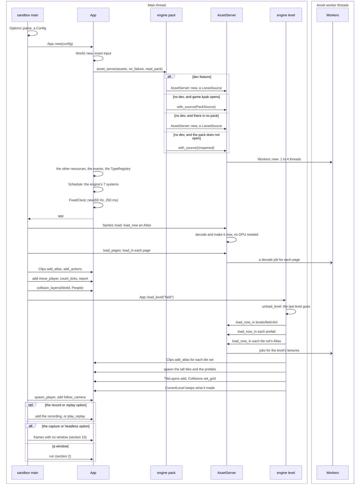
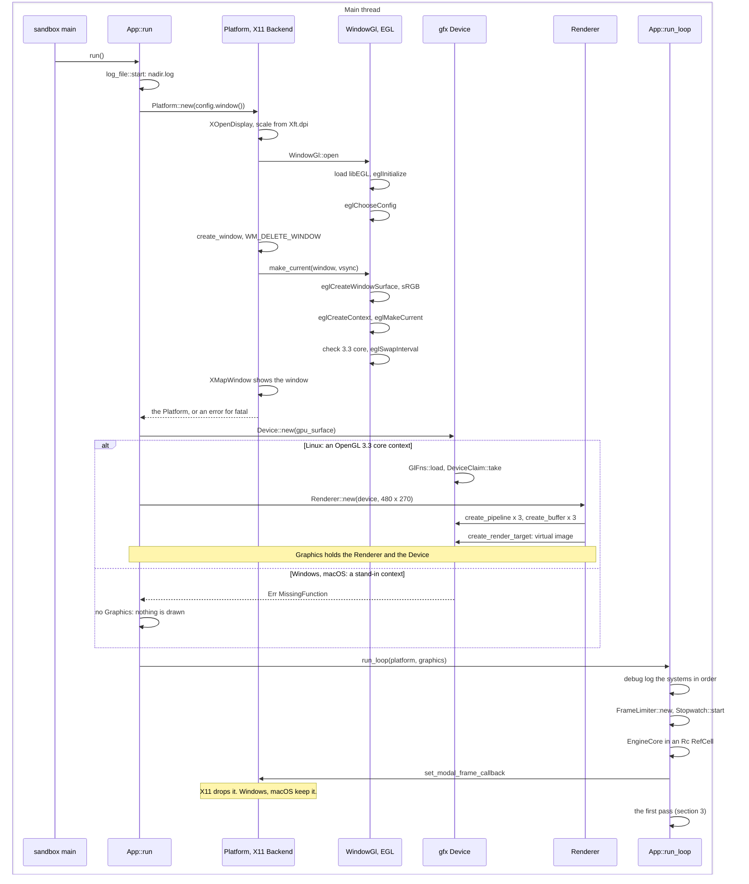
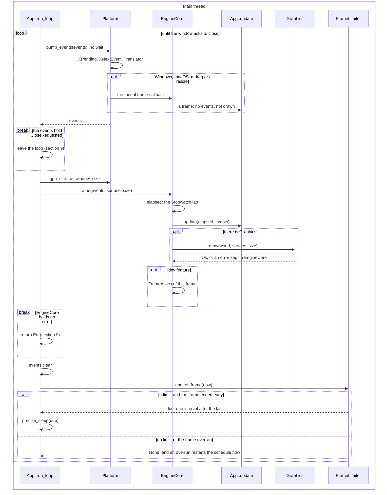
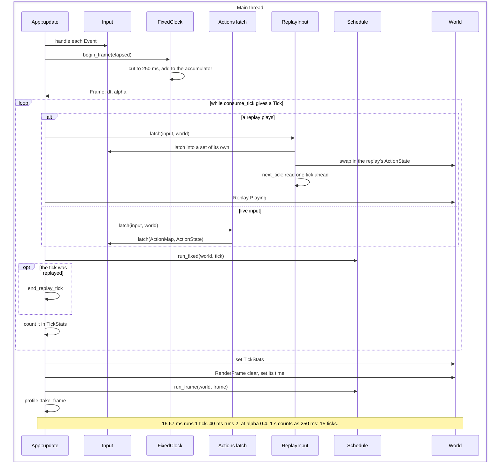
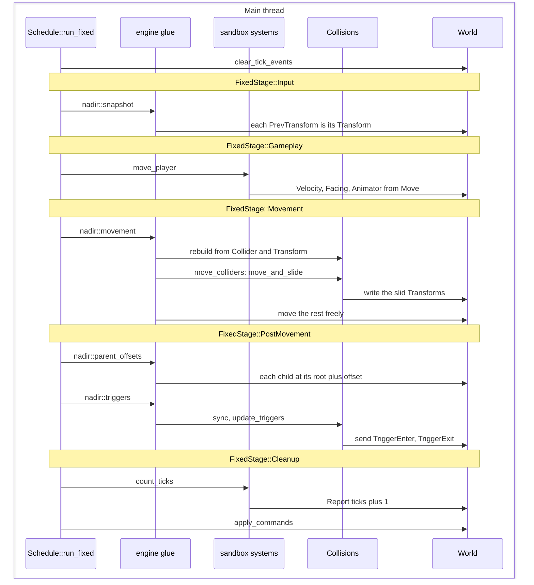
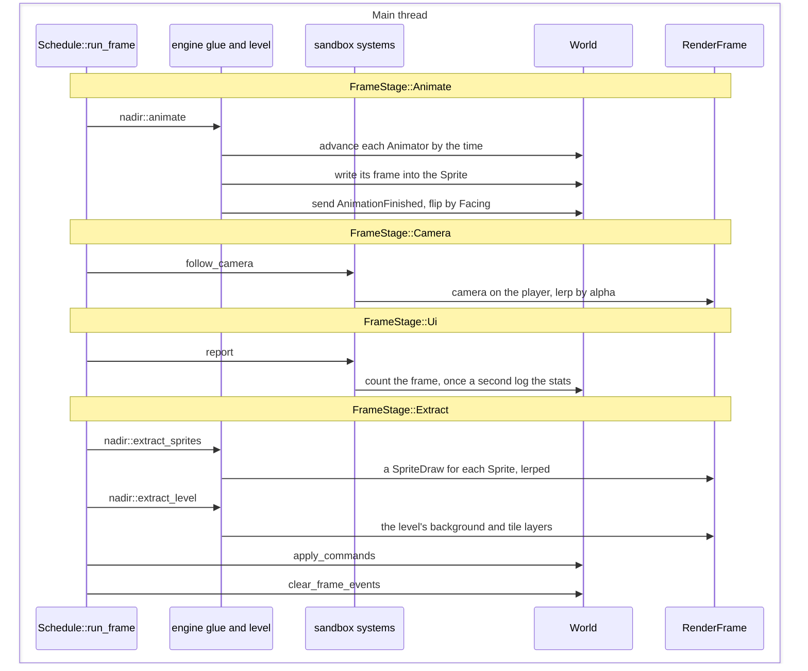
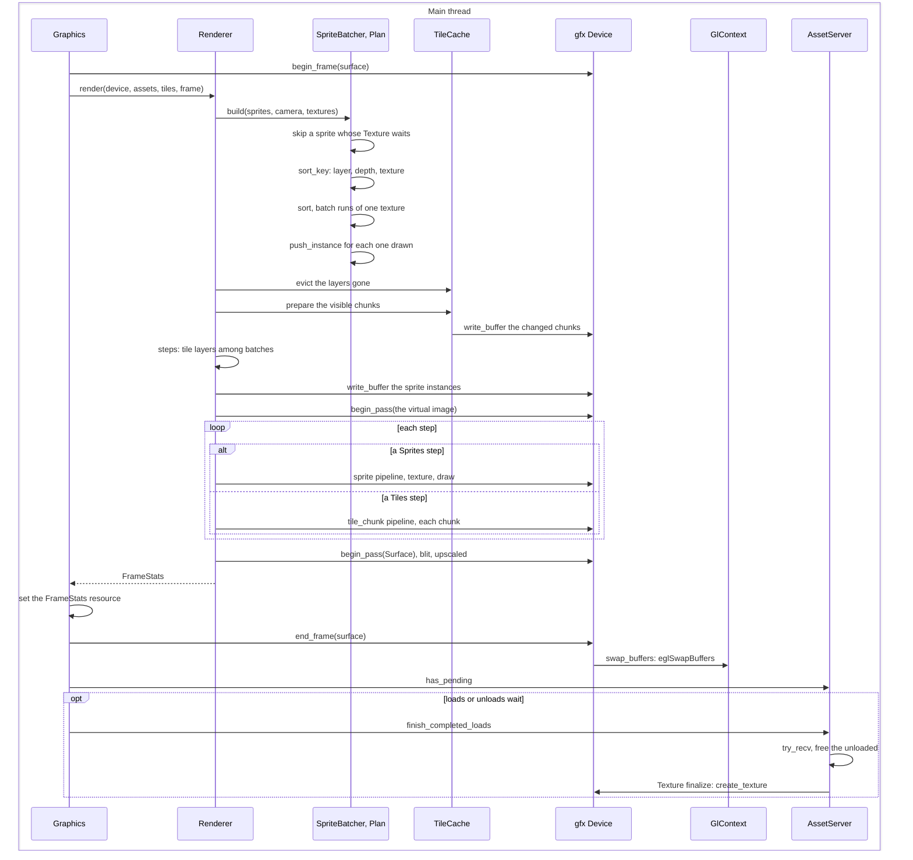
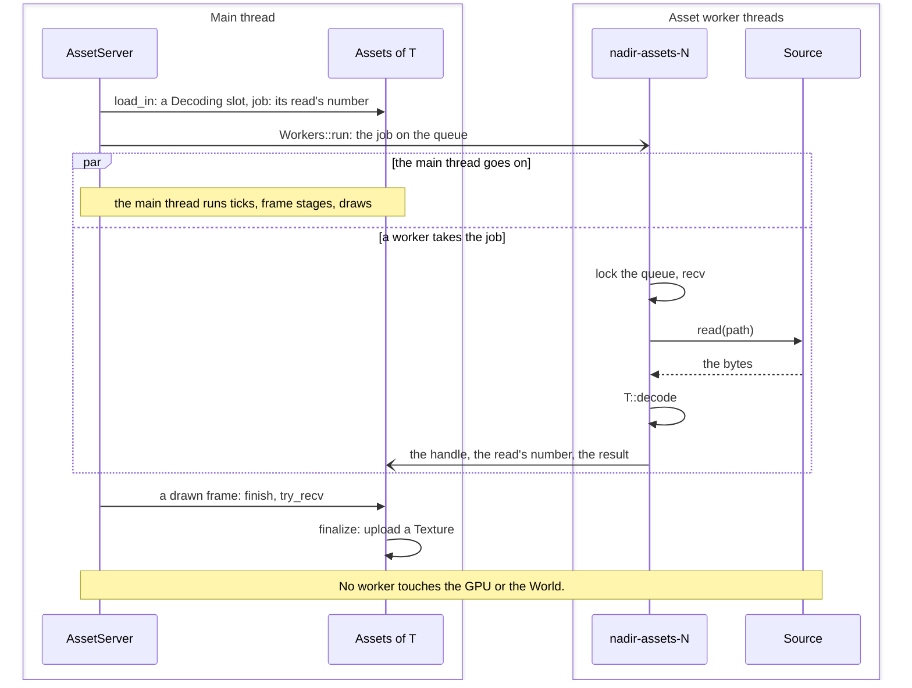
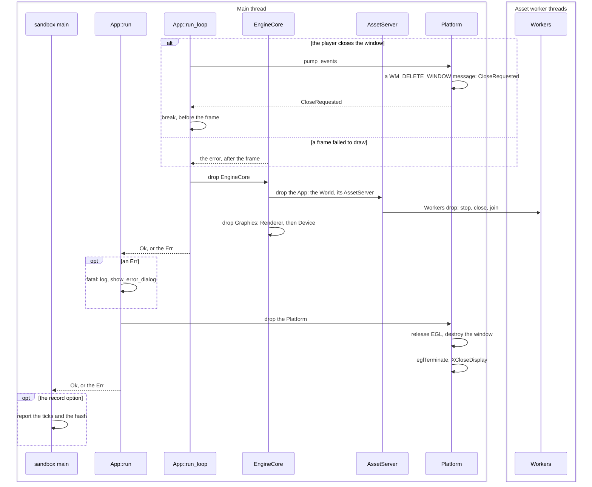
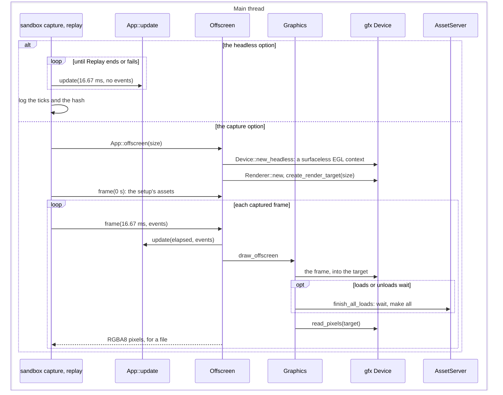

# Game loop sequence diagrams

These diagrams follow the game loop through the code: how the sandbox sets
up and opens its window, what one pass of the main loop does, from the
window's events through the 60 Hz ticks and the frame stages to the draw
and the swap, and how the game shuts down. They reflect the code at commit
`0cba65f` (version 0.2). The simulation and the drawing share the main
thread: a frame runs its ticks, then its frame stages, then draws. Only the
asset workers run beside it.

How to read them:

- A box is a thread. The main thread is the one that calls `App::run`.
- A solid arrow is a call, and a dashed arrow its answer. A solid arrow
  with an open head sends a job or a result through a channel to another
  thread, without waiting.
- `nadir::snapshot` and the like are the engine's systems, named as the
  schedule lists them. `move_player`, `count_ticks`, `follow_camera` and
  `report` are the sandbox's, in its default scene, the field.
- The other names are types and functions of the code.

## 1. Setup, before the window opens

`App::new` builds the world, the schedule and the `AssetServer`, which reads
loose files with the `dev` feature, and without it the pack `game.kpak` when
there is one. The sandbox then loads its atlas and the level `field` before
`App::run` opens anything, so the workers decode their textures with no GPU
device to make them yet. Then it calls `App::run`, or, with the capture or
headless option, runs frames with no window (section 10).

## 2. Startup: the window, the GPU and the loop

`App::run` opens the log file, the window and its OpenGL context, then the
device and the renderer, and enters `run_loop`. Windows and macOS have no
OpenGL context yet (roadmap M2.6 and M2.7), so there the game runs undrawn.

The first frame's lap is only the time since `Stopwatch::start` in
`run_loop`, well under a tick, so it runs no tick. The textures queued in
setup are made at the end of a drawn frame, once a worker has decoded them
and within the 2 ms budget, so they show from the second frame at the
earliest.

## 3. One pass of the main loop

`run_loop` pumps the window's events, runs one frame through
`EngineCore::frame`, which calls `App::update` (sections 4 to 6) and
`Graphics::draw` (section 7), and then waits for the frame limiter. A close
request ends the loop before its frame runs.

On Windows the modal callback runs every 10 to 16 ms while the window is
dragged or resized, and on macOS once for each step of a resize. `precise_sleep`
sleeps until 1 ms before the due time, then spins.

## 4. The ticks of a frame: App::update

`App::update` feeds the events to `Input`, then runs every tick that is due
at 60 Hz, each with its own latch of the actions, and then the frame stages
once. `FixedClock` counts a frame for at most 250 ms, so a stall runs at
most 15 ticks, and the rest of it is lost.

`Input` keeps the key and button changes in order, so a latch gives each
tick its own presses and releases, and a tap between two ticks still
counts. Before `add_actions`, and while a replay plays, the live input is
latched into a set of its own that nothing reads. `end_replay_tick` sets
`Replay` to `Ended` or `Failed` when no tick follows, and the input is live
from then on. The `RenderFrame`'s time is the ticks so far plus `alpha`.

## 5. One tick: Schedule::run_fixed

The tick stages run in order, and in each stage the engine's systems come
before the game's, one at a time. The commands they queued apply once,
after the last stage.

`nadir::snapshot` also gives a `PrevTransform` to each drawn entity that
has none. `move_colliders` moves the entities with a `Collider` and a
`Velocity` in collider order, each seeing where the ones before it went.

## 6. The frame stages: Schedule::run_frame

After the ticks, the frame stages run once. They animate, put the camera
between the last two ticks, and fill the `RenderFrame` that section 7
draws.

`nadir::animate` advances by how far `RenderFrame` time moved since the
last frame, and writes the clip frame's texture and uv, and its size and
pivot when the frame has a placement. A
sprite is drawn `alpha` of the way from its `PrevTransform` to its
`Transform`, and a child where its root is drawn, plus its offset.

## 7. Drawing, presenting, and the finished loads

`Graphics::draw` renders the `RenderFrame` into the virtual image, scales
it into the window by the largest whole factor, and swaps. Then, on the
main thread, it makes the assets that the workers have decoded, within a
2 ms budget.

The depth in a sort key is the pivot's y for a y-sorted sprite, or a fixed
depth. Ties keep their submission order. A chunk goes to the GPU the first
time the view shows it, and again only after one of its tiles changes. Each
draw is one `glDrawArraysInstanced`.

## 8. The asset worker threads

A load returns a handle at once. A worker reads and decodes the file, and
the main thread makes the asset at the end of a later drawn frame (section
7).

A `LooseSource` reads a file. A `PackSource` reads an entry of the pack, in
turns with the other workers, and checks and decompresses it. A panic in a
read or a decode fails the asset, and with no worker thread a job runs on
the thread that asked.

## 9. Shutdown

The loop ends on a close request or on a frame's error, which is logged and
shown before the window goes. `EngineCore` drops first, the app before the
GPU device, and then the `Platform` closes the window.

A worker finishes the job it is running, and the queued ones are dropped
unrun. The `Device` deletes its GL objects while the context is still
current. This is the Linux order: on Windows and macOS the modal callback
holds a second `Rc` of the `EngineCore`, which then drops with the
`Platform`.

## 10. Frames without a window

Tests, benchmarks and two of the sandbox's options run frames with no
window. `App::update` alone draws nothing, so no load finishes, while
`App::offscreen` draws into a render target and waits for every load, so
that a recording is the same each time.

## Not shown, because it is not built yet

- The audio thread and its mixer (roadmap M6).
- The game reloading what changed (M5.8). nadir-assets' reload behind a
  handle and its watcher thread (M5.16), and nadir-render's program
  rebuilt from new sources (M5.17), are built, but the facade does not
  start or call them yet, so the loop does not reach them.
- Gamepads (M8), bitmap text (M7.1), and the debug UI, profiler and console
  (M7.2 to M7.6).
- Drawing on Windows and macOS (M2.6, M2.7), and the Metal backend (M10).
  There the loop runs as section 3 shows, with no `Graphics`.

## Sources

- `crates/engine/src/app.rs`, `glue.rs`, `level.rs`, `pack.rs`,
  `limiter.rs`, `replay.rs`, `tick_stats.rs`, `frame_allocs.rs`,
  `collisions.rs`, `animation.rs`, `log_file.rs`
- `crates/core/src/time.rs`
- `crates/ecs/src/schedule.rs`, `world.rs`, `events.rs`
- `crates/input/src/input.rs`
- `crates/assets/src/server.rs`, `assets.rs`, `workers.rs`, `source.rs`
- `crates/render/src/renderer.rs`, `batcher.rs`, `plan.rs`, `sort.rs`,
  `frame.rs`, `chunks.rs`, `texture.rs`, `atlas.rs`
- `crates/gfx/src/device.rs`, `gl/mod.rs`
- `crates/platform/src/lib.rs`, `sleep.rs`, `linux/x11.rs`,
  `linux/x11/input.rs`, `linux/x11/connection.rs`, `linux/egl.rs`
- `games/sandbox/src/main.rs`, `replay.rs`, `capture.rs`
